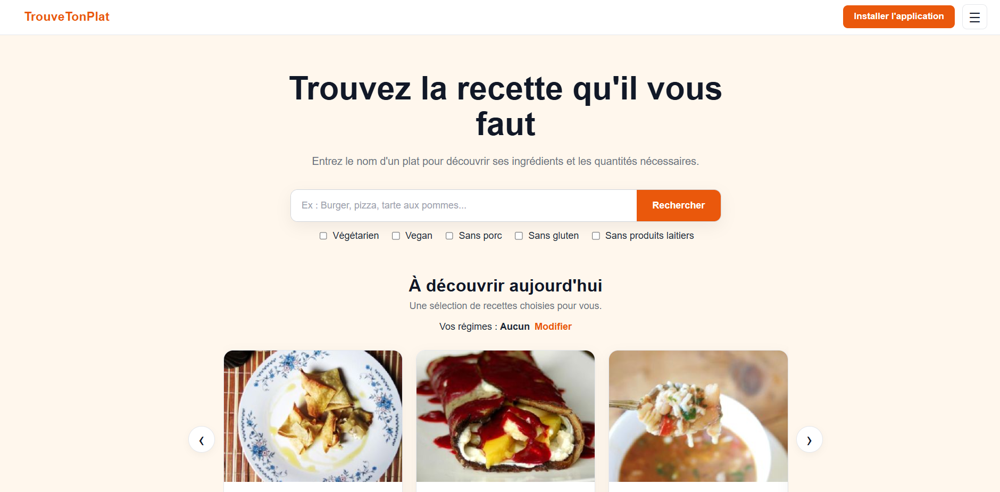
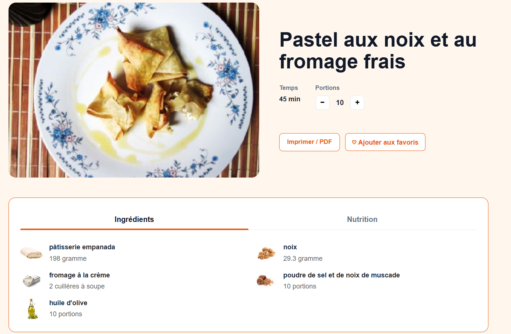

# TrouveTonPlat

TrouveTonPlat est une application web permettant de rechercher facilement des recettes selon ses envies et ses contraintes alimentaires.

🌐 **Site :** https://trouvetonplat.fr

## Aperçu

L'objectif de TrouveTonPlat est de rendre la recherche de recettes plus simple et plus agréable, en proposant des résultats adaptés aux préférences de l'utilisateur tout en limitant les recherches sans résultat.

Le projet utilise principalement l'API Spoonacular, complétée par plusieurs fonctionnalités développées autour de l'expérience utilisateur.

## Fonctionnalités principales

- 🔎 Recherche de recettes avec autocomplétion
- 🥗 Filtres : végétarien, végan, sans porc, sans gluten et sans produits laitiers
- 🔄 Recherche alternative lorsqu'une requête trop précise ne retourne aucun résultat
- ⭐ Gestion des recettes favorites
- 💡 Découvertes quotidiennes adaptées aux préférences
- 🧭 Conservation de la recherche, des filtres et de la position lors du retour depuis une recette
- 👥 Adaptation des quantités selon le nombre de portions
- 📊 Informations nutritionnelles
- 🖨️ Version imprimable / PDF des recettes
- 📱 Interface responsive et installation en PWA

## Aperçu du site

## Technologies

**Frontend :** React, JavaScript, HTML, CSS  
**Backend :** Node.js, Express  
**API :** Spoonacular  
**Déploiement :** Vercel, Railway

---

Projet personnel réalisé dans le cadre de mon portfolio de développement web.
